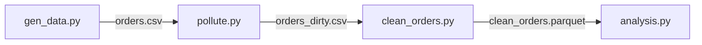

# w04-data · 订单数据管道

一个迷你但完整的数据管道练习项目：把一批原始订单数据依次经过
**生成 → 注污 → 清洗 → 分析** 四个阶段，模拟真实数据工程的最小闭环。

- **技术栈**：Pandas（数据处理）+ DuckDB（SQL 分析）+ Polars（LazyFrame 重写对比）
- **项目背景**：AI 转岗学习计划 W4 交付物，重点练习清洗链路、SQL 窗口函数与跨引擎对账

## 流程图



## 各模块说明

| 模块 | 职责 | 产物 |
|---|---|---|
| `gen_data.py` | 生成原始订单数据（seed=42 可复现） | `orders.csv` |
| `pollute.py` | 注入四类脏数据：缺失 / 异常 / 空串 / 日期格式 | `orders_dirty.csv` |
| `clean_orders.py` | 五步清洗 + 添加 row_id 主键，落盘列式存储 | `clean_orders.parquet` |
| `analysis.py` | agg / transform / merge / pivot 分组分析演示 | 终端输出 + `city_pop.csv` |
| `polars_clean.py` | 同一清洗链路的 Polars LazyFrame 实现（对账用） | `clean_orders_polars.parquet` |

## 运行方式

```bash
# 端到端：生成 → 注污 → 清洗 → 分析
python pipeline.py all

# 只跑单步（可选 gen / pollute / clean / analyze）
python pipeline.py clean

# 查看所有子命令
python pipeline.py --help
```

> 说明：`analysis.py` 目前读原始 `orders.csv` 做教学演示，尚未消费
> `clean_orders.parquet`，计划在 v0.2 接入清洗产物。
